# Tutorial: sort your first batch of new music

This walks you through music-cluster from installing it to filing a folder of
new tracks into the crates you already keep, and putting everything back if
you change your mind about where files went. Each step shows the desktop app and the equivalent
command, so you can follow along with either.

By the end you will have:

1. installed the app,
2. taught it your existing genre folders,
3. checked how well it can tell them apart,
4. sorted a folder of new music, reviewing every suggestion,
5. filed the results (with a dry run first, and an undo afterwards),
6. and seen discovery, auto-tags, samples and the settings.

The screenshots come from a small demo library: three genre folders (Deep
House, Drum & Bass, Techno) with eight tracks each, and a folder of six new
tracks. Your own library will have more of everything, but the screens are the
same. Every command used here is described in full in the
[command-line reference](cli.md).

**Contents**

- [1. Install](#1-install)
- [2. Open the app](#2-open-the-app)
- [3. Create a collection](#3-create-a-collection)
- [4. Import your folders as groups](#4-import-your-folders-as-groups)
- [5. Fit, and check your groups](#5-fit-and-check-your-groups)
- [6. Sort a folder of new music](#6-sort-a-folder-of-new-music)
- [7. Review the suggestions](#7-review-the-suggestions)
- [8. File the results: dry run, commit, undo](#8-file-the-results-dry-run-commit-undo)
- [9. No folders yet? Break down a pile](#9-no-folders-yet-break-down-a-pile)
- [10. Browse the library and its auto-tags](#10-browse-the-library-and-its-auto-tags)
- [11. Samples](#11-samples)
- [12. Settings](#12-settings)
- [Where to go next](#where-to-go-next)

## Before you start

Two promises shape everything below:

- **You define the groups.** The tool learns from folders you already keep, or
  from candidates you explicitly keep. It never invents a category on its own.
- **Nothing on disk changes until you say so.** Analysing, sorting and
  reviewing only write to the tool's own database. Your audio files are only
  touched when you commit a session, after a preview of exactly what will
  happen, and the file operations of every commit can be undone (with one
  exception: overwriting, see [step 8](#8-file-the-results-dry-run-commit-undo)).

You will need:

- **FFmpeg**, which decodes the audio. Check with `ffmpeg -version`; install it
  with `brew install ffmpeg` (macOS), `sudo apt-get install ffmpeg`
  (Debian/Ubuntu) or `winget install ffmpeg` (Windows).
- A **folder of genre folders**, for example `~/Music/DJ/Deep House`,
  `~/Music/DJ/Techno`. Two folders is the minimum; a dozen or more tracks in
  each gives the best results.
- A **folder of new music** to sort, for example `~/Downloads/NewMusic`.

## 1. Install

**The desktop app.** Download the installer for your platform from the
[releases page](https://github.com/julesyoungberg/music-cluster/releases): a
`.dmg` for macOS, `.msi` for Windows, `.AppImage` or `.deb` for Linux. It
includes everything except FFmpeg. The builds are unsigned, so the first launch
needs a right-click → **Open** on macOS, or **More info → Run anyway** on
Windows.

**From source** (for the command line, or to run the app in development).
Python 3.10–3.12 and Node.js 18+:

```bash
git clone https://github.com/julesyoungberg/music-cluster.git
cd music-cluster
python -m venv .venv && source .venv/bin/activate    # Windows: .venv\Scripts\activate
pip install -r requirements.txt
pip install -e .

music-cluster init
```

`init` creates the database (`~/.music-cluster/library.db`), the settings file
(`~/.music-cluster/config.yaml`) and a first collection called `My Folders`.
[INSTALL.md](../INSTALL.md) covers other platforms, building the desktop app
yourself, and troubleshooting.

## 2. Open the app

Launch the installed app, or from a source checkout:

```bash
cd ui && npm install && cd ..
python start-dev.py              # then open http://localhost:1420
python start-dev.py --tauri      # or as a desktop window
```

The bar along the top is the whole app:

| Screen | What it is for |
| --- | --- |
| **Overview** | Library totals, whether your groups are fitted, and anything waiting for you to review. |
| **Groups** | The folders you sort into: import them, set destinations, check for overlap. |
| **Sort** | Sessions of new music being reviewed and filed. |
| **Discover** | Breaking an unsorted pile into candidate groups. |
| **Library** | Every analysed file, with search, auto-tag filters and "sounds like". |
| **Settings** | How confident the sorter must be, filing defaults, analysis and appearance. |

The menu at the top right picks the **active collection**: the set of groups
everything else works with.

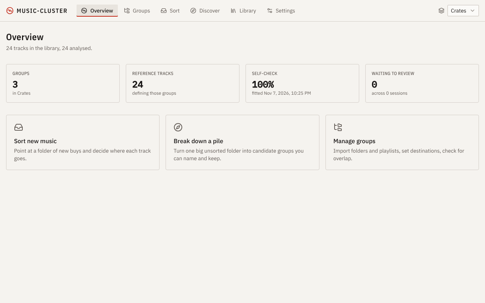

On a brand-new install the overview says *No collections yet* (unless you ran
`music-cluster init`, which made one), and offers **Set up your groups**.

## 3. Create a collection

A **collection** is one sorting scheme: a set of groups that new music gets
filed into. Most people need exactly one. You would make a second to sort
samples as well as tracks (see [Samples](#11-samples)), or to keep two
different ways of slicing the same music.

Open **Groups** and click **New collection**. Give it a name, choose **Music**
(full-length tracks) or **Samples** (one-shots and loops), and click
**Create**. The choice is fixed once the collection exists, because tracks and
samples are measured differently.

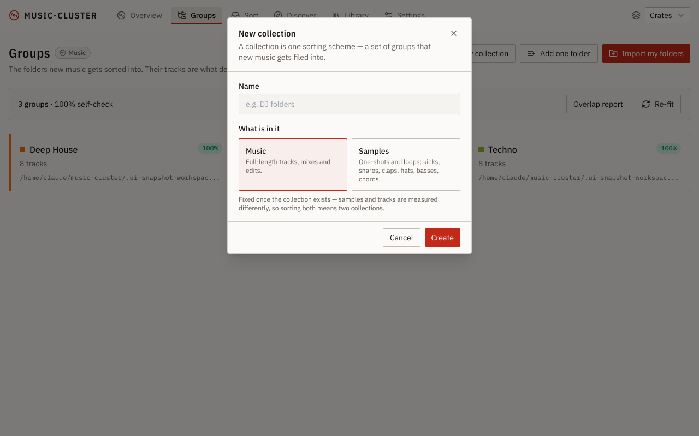

From the command line:

```bash
music-cluster collection create "DJ folders"
```

If you ran `music-cluster init`, you already have one called `My Folders` and
can skip this step.

## 4. Import your folders as groups

A **group** is one of your folders. Its tracks are the **reference tracks**
that teach the sorter what belongs there, and the folder itself is the
group's **destination**: where new music sorted into it will be filed.

If your music already lives in genre folders under one parent folder, import
them all at once. On **Groups**, click **Import my folders**, browse to the
parent folder (the one *containing* your genre folders, here `DJ`), and click
**Import**.

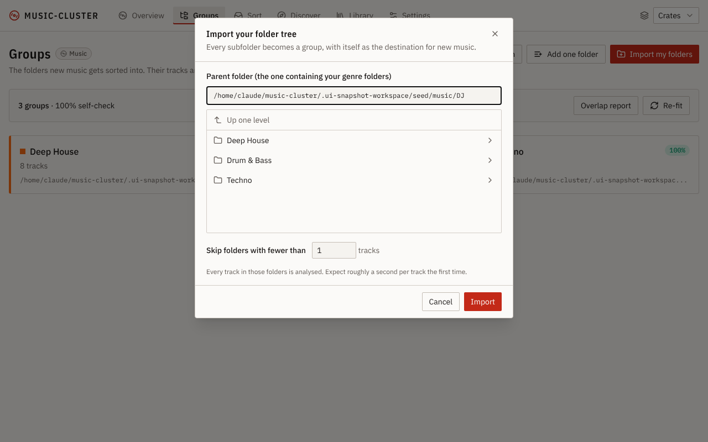

Every subfolder becomes a group. **Skip folders with fewer than … tracks**
leaves out near-empty folders. Every track is analysed the first time, at
roughly a second per track using every CPU core, so a few thousand tracks take
a while; a progress bar shows how far it has got. Analysis happens once per
file. Everything after this is instant.

When it finishes, each group shows its track count and destination folder:

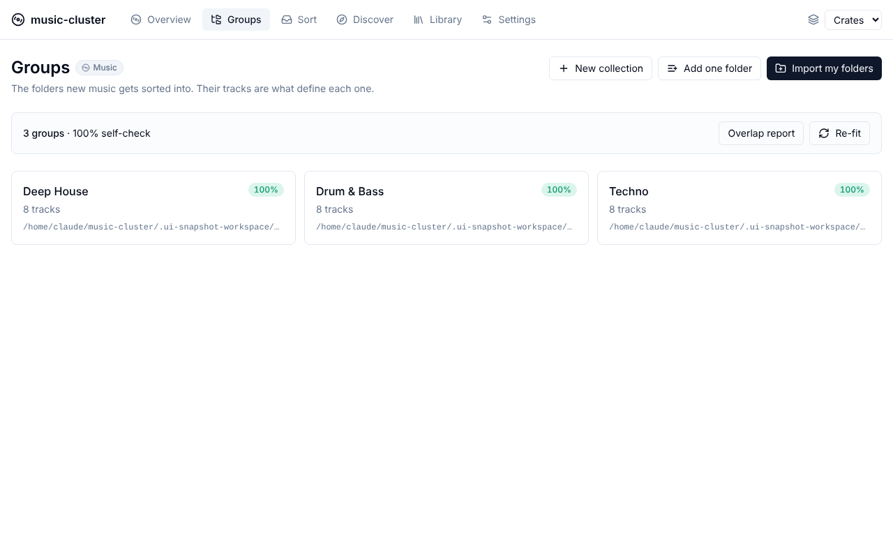

Click a group to see its reference tracks, rename it, add notes, give it a
**colour**, change its destination folder (**Choose folder**), or remove individual tracks with the
✕ next to them. **Delete group** removes the group from the collection; its
tracks stay in your library and on disk.

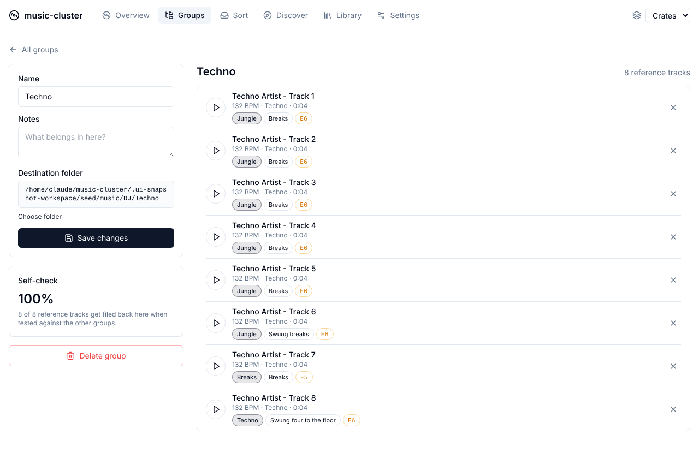

The colour is the group's crate colour: it marks the group wherever it appears,
in its score bars and swatches while you review, so you can tell crates apart
at a glance. It saves as soon as you pick it.

Other ways to build a group:

- **Add one folder** (on Groups) imports a single folder as a group.
- In **Library**, tick tracks and click **Add N to a group** to use them as
  references for an existing group.
- From the command line, `groups add` builds a group from a folder, an M3U
  playlist, or individual seed tracks.

```bash
music-cluster groups import-tree ~/Music/DJ --collection "DJ folders"
music-cluster groups add "Warm-up" --playlist ~/Playlists/warmup.m3u8 --destination ~/Music/DJ/Warm-up
music-cluster groups list
```

A group with no destination folder can still collect tracks into a playlist,
but cannot have files copied or moved into it. The groups screen warns you
about any group without one.

## 5. Fit, and check your groups

Before it can suggest anything, the sorter has to **fit** the collection:
learn what each group sounds like, and in particular what separates your
groups from each other. It takes seconds. Click **Fit** on the Groups screen
(or **Fit now** on the overview), or run:

```bash
music-cluster fit
```

Fitting also runs a **self-check**: every reference track is sorted again with
itself hidden from its own group, and the share that comes back to where you
filed it is that group's accuracy. You see it as a percentage on each group,
and as the overall number on the overview.

Click **Overlap report** for the details:

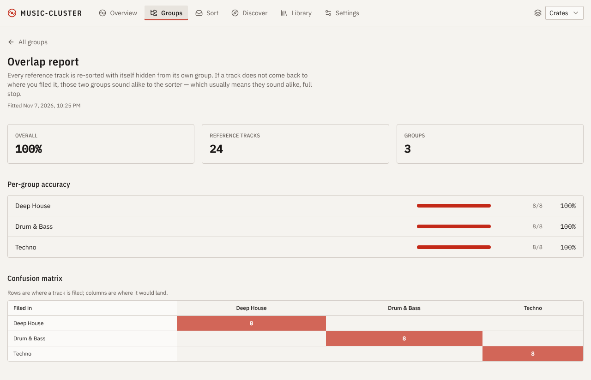

- **Groups needing attention** (only when there are any) lists groups that
  were left out of the fit: ones with no reference tracks, or whose tracks have
  not been analysed.
- **Most easily confused** (only when some tracks land in the wrong group)
  lists pairs, e.g. *52 tracks from Minimal look like Tech House*.

The demo library in the screenshot separates perfectly, so it shows neither.
- **Per-group accuracy** ranks the groups from least to most distinct.
- The **confusion matrix** shows, for each group (rows), where its tracks
  would land (columns).

Low accuracy is information about your folders, not just about the tool: two
groups that overlap this much either really are one style, or need clearer
reference tracks showing what separates them. You can merge them, move some
tracks between them, or add more examples, then fit again. The same report on
the command line:

```bash
music-cluster check
```

Fit again whenever you change a group's tracks or a sorting setting.

## 6. Sort a folder of new music

Open **Sort** and click **New sort**. Browse to the folder of new music, give
the session a name if you like (it defaults to the folder name), and click
**Start**.

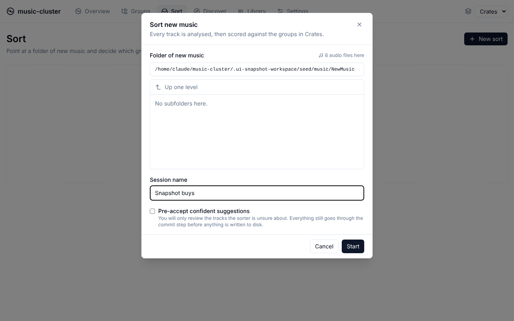

**Pre-accept confident suggestions** accepts every track the sorter is sure
about, so you only review the uncertain ones. You still see and confirm
everything before any file is written.

Each new track is analysed and scored against every group. The result is a
**session**: a saved queue of suggestions that you can leave and come back
to. Sessions with tracks still to review appear on the overview under
*Waiting on you*.

The command-line version scores the folder and then drops you straight into
the review:

```bash
music-cluster sort ~/Downloads/NewMusic --name "November buys"
```

## 7. Review the suggestions

The session opens on its first track:

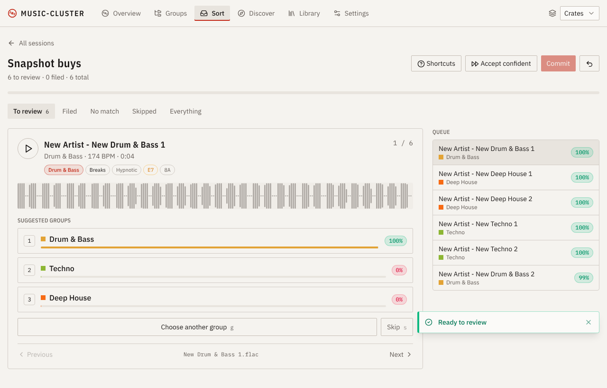

- At the top: the track, its tempo, key and length, its
  [auto-tags](#10-browse-the-library-and-its-auto-tags), and a waveform. Press
  the play button (or **Space**) to listen; the player bar at the bottom of the
  window keeps playing while you move around.
- **Suggested groups** ranks your groups with a confidence for each, each
  bar in its group's crate colour. A track
  that is far from all of them says so (*Nothing in this collection sounds
  close to this track*) instead of being forced into the least-bad group.
- On the right, the **queue** lists every track with its top suggestion.
- The tabs above filter the queue: **To review**, **Filed**, **No match**,
  **Skipped**, **Everything**.

Decide with the mouse, or much faster with the keyboard:

| Key | Action |
| --- | --- |
| `1`–`5` | File into the first to fifth suggested group |
| `g` | Choose any group from the full list |
| `s` | Skip this track (it will not be filed) |
| `Space` | Play / pause |
| `←` `→` (or `k` `j`) | Previous / next track in the queue |
| `?` | Show these shortcuts |

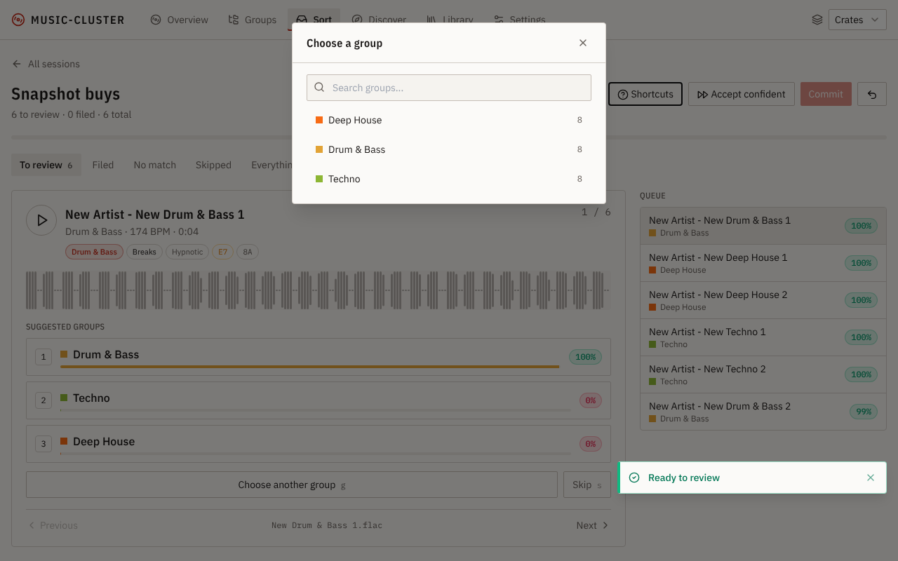

Each decision is saved immediately and the next track comes up. **Accept
confident** files every remaining track whose top suggestion clears the
confidence threshold (set in [Settings](#12-settings)) in one go; you can
check the result on the **Filed** tab.

When the queue is empty, the session says how many tracks are ready to file:

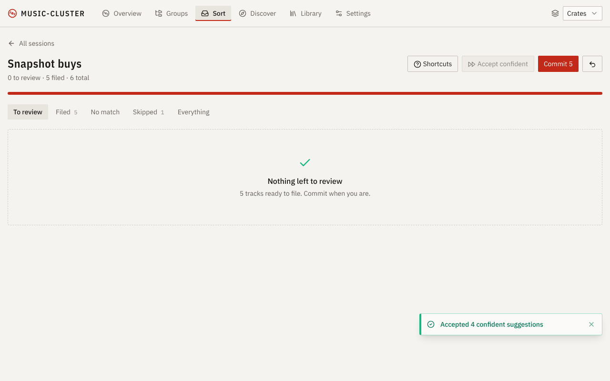

On the command line the review is a prompt: type `1`–`5` (or press Enter for
the top suggestion), `s` to skip, `l` to list every group and pick one by ID,
or `q` to stop and resume later with `music-cluster review <session>`.

```
────────────────────────────────────────────────────────────────────────
New Artist - New Deep House 1   [5 left]
0:04  122 BPM  Deep House

  1.  100%  Deep House
  2.    0%  Techno
  3.    0%  Drum & Bass

  [1-5] file it   [s] skip   [l] list all groups   [q] quit
  >
```

## 8. File the results: dry run, commit, undo

So far nothing has been written. Click **Commit** (it shows how many tracks
are ready). The dialog that opens is a **dry run**: it lists exactly what
would happen, and nothing happens until you click **Commit** inside it.

Choose how to file at the top. The dialog opens on **Copy files**; the
**Default mode** in Settings applies to `music-cluster apply` on the command
line.

| Mode | What it does |
| --- | --- |
| **Playlists only** | Writes one playlist (`.m3u8`) per group. No audio file is touched. The safest choice. |
| **Copy files** | Copies each track into its group's destination folder. The original stays where it was. |
| **Move files** | Moves each track into its destination folder, and the library follows it. |
| **Symlink** | Puts a link in the destination folder; the original stays put. |

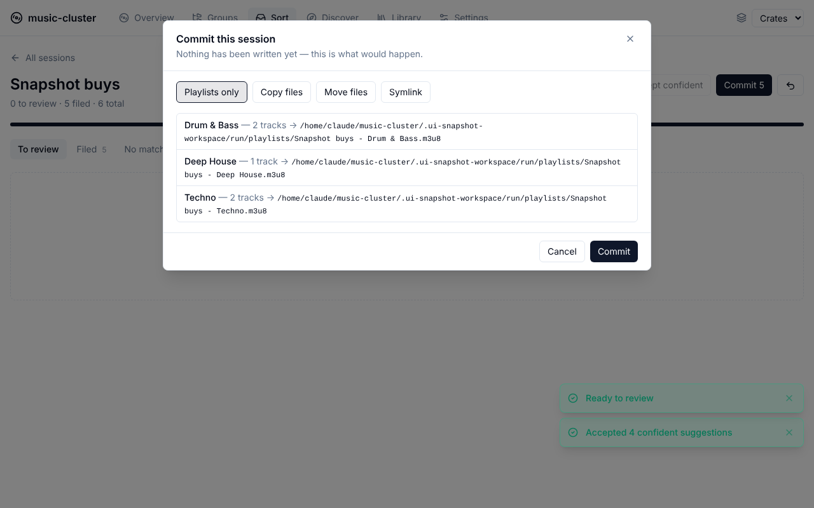

Switching mode updates the preview. In **Move files** mode the dialog reminds
you that the originals will be relocated, and that the session records every
move:

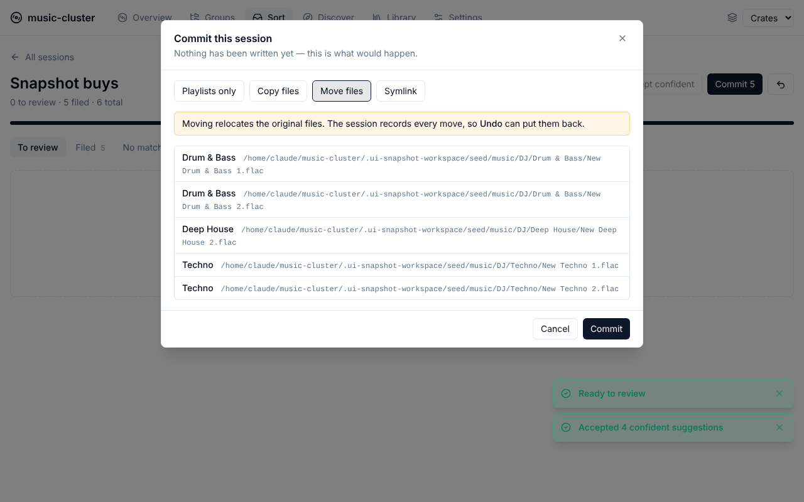

Tracks that cannot be filed are listed as skipped, with the reason: the group
has no destination folder, the file is already there, or a file with the same
name is already in the destination (what happens then is set in Settings:
skip, rename or overwrite).

> **Overwrite cannot be undone.** If a filing replaces a file that was
> already in the destination, the replaced file is not kept anywhere, and
> undo cannot bring it back. Leave the conflict setting on *Skip* (the
> default) or *Rename* unless you are sure.

Click **Commit** to do it. A notice confirms what was written:

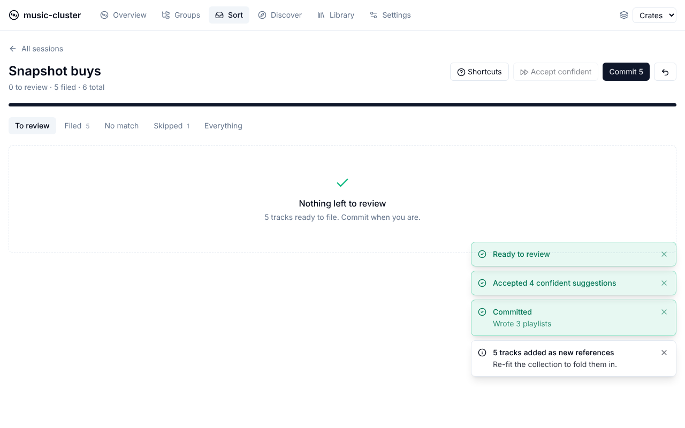

If **Learn from every commit** is on in Settings (it is by default), the
filed tracks also become reference tracks of their groups, so the sorter keeps
up with your taste. Fit the collection again to fold them in.

**Undo.** The ↶ button next to Commit reverses the session's file operations.
In the screenshot the session was committed as playlists, which undo leaves in
place, so it reports *Reversed 0 operations*:

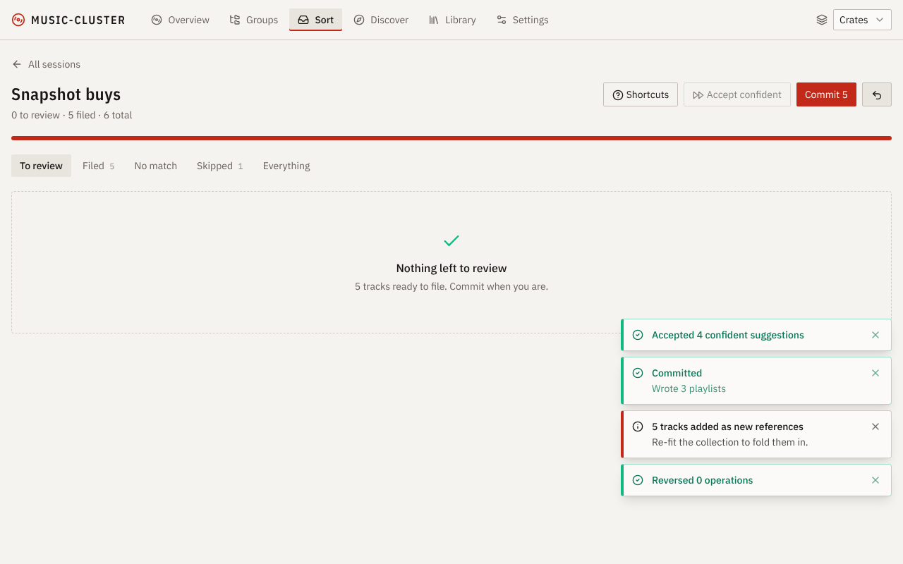

| Mode | What undo does |
| --- | --- |
| Move | Moves every file back to where it came from. |
| Copy | Deletes the copies. The originals were never touched. |
| Symlink | Deletes the links. |
| Playlists | Leaves the playlists in place. (`music-cluster undo --remove-playlists` deletes them.) |

Undo only reverses what happened on disk. Tracks that were added to their
groups as references (by *Learn from every commit*) stay in those groups;
remove them from the group screen if you no longer want them there. The
session's decisions also count as applied, so it cannot be committed a second
time.
The same on the command line, where `apply` always prints the plan first and
asks before doing anything:

```bash
music-cluster apply 1 --mode move --dry-run    # show the plan and stop
music-cluster apply 1 --mode move              # show the plan, confirm, then do it
music-cluster undo 1                           # reverse the file operations
```

```
Mode: move

  move     New Drum & Bass 1.flac -> /Users/you/Music/DJ/Drum & Bass/New Drum & Bass 1.flac

Dry run — nothing was changed.
```

That is the whole loop. Next time you buy music: **Sort → New sort**, review,
commit.

## 9. No folders yet? Break down a pile

If your music is one big unsorted folder, **Discover** proposes groups for you
to keep or throw away. Nothing becomes a group until you say so.

Open **Discover**, click **New run**, and pick the folder:

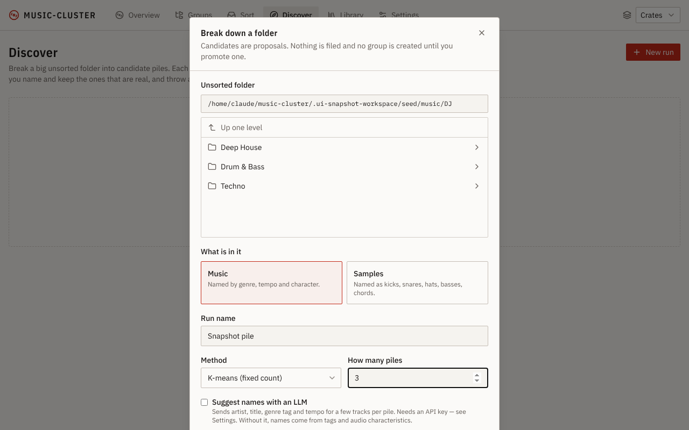

- **What is in it**: music is named by genre, tempo and character; samples
  are named as kicks, snares, hats, basses, chords.
- **Method**: *Density* finds its own number of piles (and ignores tracks that
  fit none); *K-means* and *Hierarchical* make the number you ask for in **How
  many piles** (or estimate it, if you leave it on Auto).
- **Smallest pile** (density only) drops piles smaller than this.
- **Suggest names with an LLM** is optional and off by default; see
  [LLM naming](#llm-naming).

Click **Find groups**. Each candidate shows a suggested name, its size,
tempo, character, the genre tags inside it, and five **representative tracks**
to audition. **Show all N tracks** lists the rest.

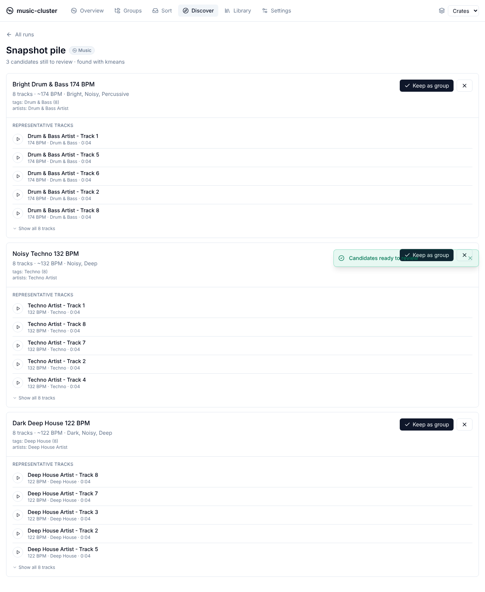

For each candidate, click **Keep as group** or ✕ to discard it. Keeping one
asks for a name and an optional destination folder. **Use only the
representative tracks** makes just those five the references, for when the
pile is roughly right but not every track in it should define the group.

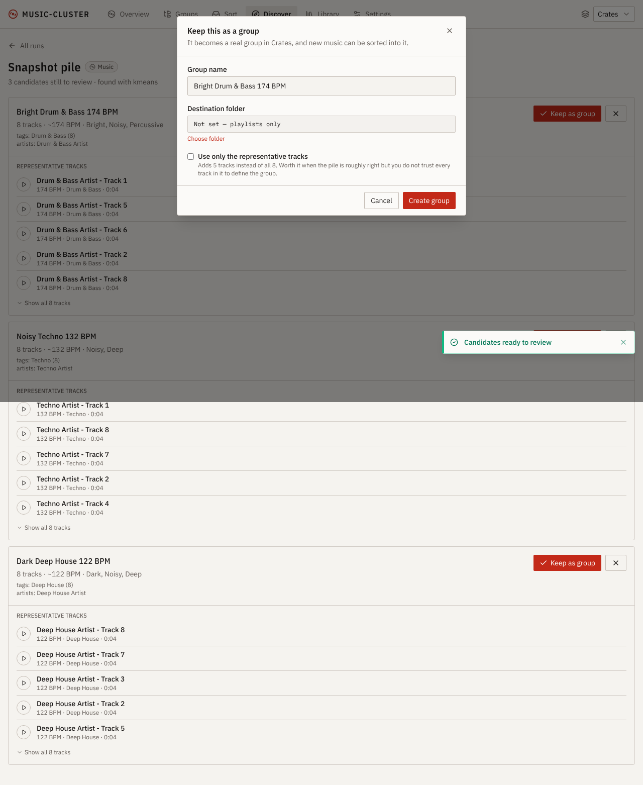

Kept groups go into the active collection. When you have kept the ones you
want, [fit](#5-fit-and-check-your-groups) and sort new music against them as
usual.

```bash
music-cluster discover ~/Music/Unsorted
music-cluster candidates 1       # y keep, s keep representatives only, n discard, q quit
music-cluster fit
```

## 10. Browse the library and its auto-tags

**Library** lists every file the tool has analysed. Search by artist, title,
album or genre; show only music or only samples; or tick **Not in any …
group** to find tracks you have not filed yet.

Music is **auto-tagged** while it is analysed, with tags in the words you would
use with another DJ:

| Tag | Values |
| --- | --- |
| Genre | House, deep house, tech house, techno, hard techno, trance, UK garage, breaks, drum & bass, jungle, dubstep, trap, baile funk, reggaeton, hip hop, downtempo, ambient |
| Beat type | Four to the floor, half-time, 2-step, breaks, baile funk, dembow, backbeat, beatless, and whether it swings |
| Mood | One or two of dark, euphoric, melancholic, aggressive, chill, hypnotic, groovy |
| Energy | 1–10 |
| Danceability | 0–1 |
| Key | With its Camelot code, for mixing in key |

The menus above the list filter by genre, beat, mood and minimum energy:

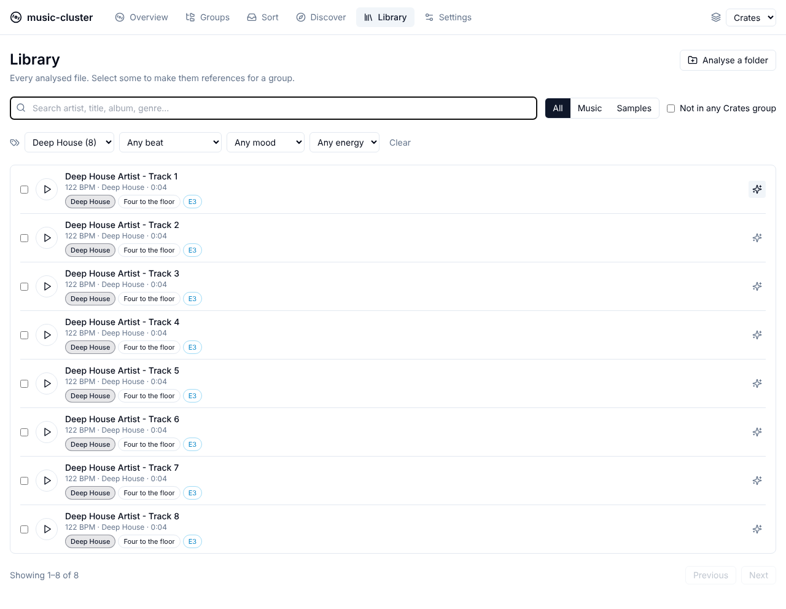

Every tag is a readable rule over measured quantities (tempo, the drum pattern
in kick, snare and hat bands, brightness, loudness and so on), not a trained
model, so it is explainable and wrong in explainable ways. Tags never move a
file or change a group. A library analysed before tagging existed shows a
**Tag N untagged tracks** button.

The ✦ button on each row finds tracks that **sound like** that one. It is a
quick way to seed a new group by hand: find a few that belong together, tick
them, and **Add to a group**.

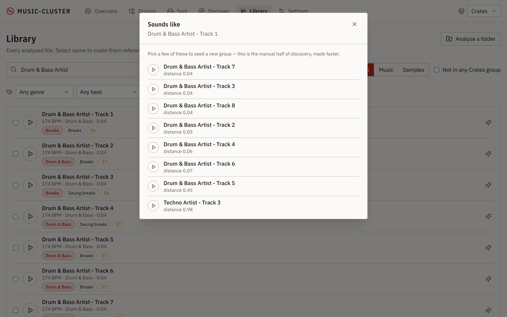

**Analyse a folder** adds files to the library without sorting them, which is
useful for preparing a big library ahead of time:

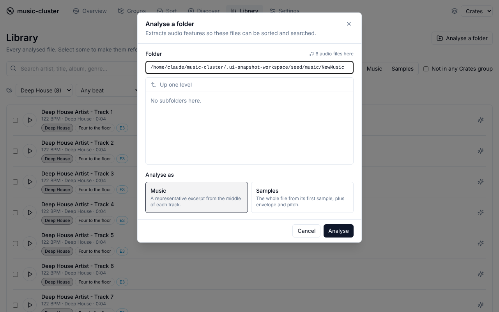

The command line has more ways to slice the tags:

```bash
music-cluster tags find --beat half_time --min-energy 7
music-cluster tags find --genre techno --mood hypnotic --camelot 8A
music-cluster tags show "roller" --why       # the scores and drum pattern behind the tags
music-cluster tags summary                   # the library by genre, beat and mood
music-cluster similar "Archangel"
```

## 11. Samples

The same workflow sorts one-shots and loops (kicks, snares, claps, hats,
basses, chords) into your sample folders. A sample collection measures each
sound's attack, decay, length, energy across eight frequency bands and pitch,
from its very first sample, which is what separates a clap from a snare.

1. **Groups → New collection**, choose **Samples**.
2. Make it the active collection (top right), then **Import my folders** with
   the parent of your `Kicks`, `Snares`, `Hats`… folders.
3. Fit, then sort a new sample pack exactly as in steps 5–8.

Tracks and samples live in the same library but in separate collections. The
command-line equivalent, plus a way to see how the tool reads a folder of
samples without changing anything:

```bash
music-cluster collection create "Drum library" --profile sample
music-cluster groups import-tree ~/Samples/Drums --collection "Drum library"
music-cluster fit --collection "Drum library"
music-cluster sort ~/Downloads/NewPack --collection "Drum library"

music-cluster samples classify ~/Samples/Unsorted     # what does each file look like?
```

For a pack with no structure, run Discover with **What is in it: Samples**;
candidates come back named *Kicks*, *Closed Hats*, *Basses* and so on.

## 12. Settings

**Settings** changes the same values as `~/.music-cluster/config.yaml`.
Changes save as soon as you move a slider or click an option.

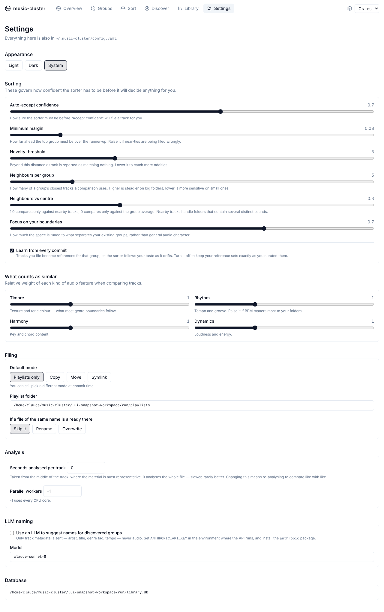

**Appearance**: light, dark, or follow the system.

**Sorting** decides how sure the sorter must be before it decides anything for
you:

- **Auto-accept confidence**: how confident a suggestion must be for *Accept
  confident* (and *Pre-accept*) to file it.
- **Minimum margin**: how far ahead of the runner-up the top group must be.
  Raise it if near-ties are being filed wrongly.
- **Novelty threshold**: beyond this distance a track is reported as matching
  nothing. Lower it to catch more oddities.
- **Neighbours per group** and **Neighbours vs centre**: whether a track is
  compared with a group's closest tracks or with its average. Nearby tracks
  handle folders that contain several distinct sounds.
- **Focus on your boundaries**: how much the comparison is tuned to what
  separates your groups, rather than general audio character.
- **Learn from every commit**: whether filed tracks become references.

**What counts as similar** weights timbre, rhythm, harmony and dynamics. Raise
rhythm if your folders follow BPM more than sound.

**Filing**: the default commit mode, where playlists are written, and what to
do when a file of the same name is already in the destination (skip, rename,
overwrite).

**Analysis**: how many seconds of each track are analysed (90 by default,
taken from the middle; 0 means the whole file. The demo library in the
screenshot analyses whole files because its tracks are only four seconds
long), and how many files are analysed in parallel.

### LLM naming

Discovery can ask an LLM to name candidate groups. It is off by default. Only
metadata (artist, title, genre tag, tempo) is ever sent, never audio. To use
it, install the `anthropic` package where the API runs and set
`ANTHROPIC_API_KEY`. In the app, tick **Suggest names with an LLM** when
starting a discovery run. The **Use an LLM to suggest names** setting turns it
on by default for `music-cluster discover`; the app's per-run checkbox decides
on its own.

After changing a sorting setting, fit the collection again. After changing the
analysis length, re-analyse (`music-cluster analyze --update <folder>`) so all
tracks are measured the same way.

## Where to go next

- [Command-line reference](cli.md): every command and option.
- [README](../README.md#how-the-sorting-works): how the sorting works under
  the hood.
- [INSTALL.md](../INSTALL.md#troubleshooting): troubleshooting.
- [FORMATS.md](../FORMATS.md): supported audio formats.
